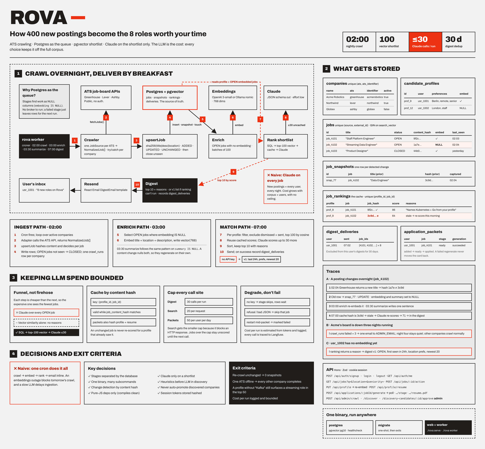

# Rova

Rova continuously discovers open roles directly from company career pages
(not job boards), tracks how they change over time, and uses AI to turn
"here are 400 new postings" into "here are the 8 roles actually worth your
time, and why" — personalized per user.

The best roles are often only on a company's own careers page, posted
through an ATS (Greenhouse, Lever, Ashby, SmartRecruiters, ...) and never
syndicated to LinkedIn/Indeed. Rova crawls those sources directly, diffs
against what it saw yesterday, and ranks what's new against each user's
profile.

## System design



- [Sketchnote](docs/design/rova-sketchnote.png) — a one-page, hand-drawn-style
  walkthrough of the crawl → enrich → match → digest pipeline.
- [System design poster](docs/design/rova-system-design-poster.png) — the
  same material as a dense reference poster: what gets stored, how LLM spend
  stays bounded, key decisions, API surface.
- [Full slide deck](docs/design/slides/) — the same content broken out into
  19 individual slides (cover, architecture, tech stack, daily pipeline,
  crawl, enrichment, AI touchpoints, matching, digest, packets, discovery,
  auth, data model, API, deployment, reliability, limits, scaling).

For the written spec behind these, see [`PRD.md`](PRD.md) (current source of
truth) and [`PLAN.md`](PLAN.md) (original phasing/rationale).

## Quick start

Requires [Bun](https://bun.sh) and Docker.

```bash
# 1. Start Postgres (pgvector) locally
docker compose up -d postgres

# 2. Install deps
bun install

# 3. Configure environment
cp .env.example .env
# at minimum: set SESSION_SECRET (openssl rand -base64 32), and either
# ANTHROPIC_API_KEY/OPENAI_API_KEY or a local Ollama for embeddings/ranking

# 4. Apply migrations
bun run db:migrate

# 5. Run the dev server
bun run dev
```

Then open `http://localhost:3000`.

## Scripts

| Command | What it does |
| --- | --- |
| `bun run dev` | Dev server (`src/main.ts serve`, hot-reloading) |
| `bun run dev:worker` | Dev worker (crawl/enrich/digest cron) |
| `bun run build` | Build the single-executable binary (see `scripts/build.ts`) |
| `bun run db:generate` | Generate a new Drizzle migration from schema changes |
| `bun run db:migrate` | Apply pending migrations |
| `bun run db:seed` | Seed the database |
| `bun run db:studio` | Open Drizzle Studio |
| `bun test` | Run the test suite |
| `bun run typecheck` | `tsc --noEmit` |

Rova also ships as one compiled binary with subcommands — `./rova serve`,
`./rova worker`, `./rova migrate`, `./rova crawl`, `./rova digest`,
`./rova enrich`, `./rova summarize`, `./rova rank`, `./rova discover`,
`./rova make-admin <email>`. `docker-compose.yml` runs the same image as
three services (`postgres`, a one-shot `migrate`, `web`, `worker`).

## Stack

Bun + Hono (API) · React + Tailwind v4 (web) · Postgres + pgvector (via
Drizzle ORM) · Claude (ranking/packet generation) · OpenAI or local Ollama
(embeddings) · Resend (digest email) · croner (scheduling).
